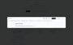

# Live file refresh

An authenticated Files preview converges on changes made inside its workspace
without being reopened. Refresh stays quiet while healthy, preserves the last
accepted presentation through transient failures, and never overwrites a dirty
browser draft. Public publish previews remain one-shot.

## Why this shape

The authenticated file ETag is the only file-version token shared by stat,
content reads, and conditional writes. The gateway derives it from filesystem
identity, size, and nanosecond change times; it is not a digest of the bytes.
That makes it useful for ordinary external-write detection, including tested
same-size rewrites, without turning individual metadata fields into browser
freshness keys. The ETag stays opaque to every browser consumer.

Polling is deliberately the first transport. A visible, already-open preview
needs bounded convergence, while a workspace filesystem event service would add
delivery, reconnection, and fanout infrastructure before the product needs
directory-wide live updates. The cadence pauses with document visibility,
serializes requests, and checks immediately on return. Replacing the transport
later must preserve the accepted-snapshot contract rather than leaking event
timing into renderers.

Remote state and editable state have different owners. `LiveFileController`
accepts read results containing bytes and a response ETag; `PreviewPane` owns
the local draft and its baseline. Entry metadata may come from an adjacent stat
when the file changes between requests, so a later stat reconciles it without
rereading unchanged content. Navigation never caches a loose stat ETag because
an identity without accepted content is not useful preview state.

Symlinks remain readable but one-shot. Their stat identity describes the link
and is intentionally null, while a content read may resolve to a target with a
different identity. Live symlink refresh would need an explicit contract for
both retargeting and target-byte changes; pretending the two identities are one
would make refresh correctness accidental.

## Invariants

- Regular authenticated files expose a quoted opaque file-version ETag;
  non-file entries expose null. The shared schema owns the wire shape and the
  gateway owns this semantic correlation.
- Browser entries retain the contract's required file type. Their discriminated
  shape makes directory type and directory presentation agree, so symlinks
  cannot silently fall through an unknown legacy case.
- Same-ETag checks do not read content or replace the accepted snapshot object.
  A changed identity starts at most one current content read.
- Hidden documents perform no cadence work. Returning to visibility invalidates
  stale work and performs one immediate check.
- A warm failure never clears accepted content or remounts the preview pane.
  Two consecutive errors carrying HTTP status 404 establish the missing state;
  reappearance at the same path recovers the open pane.
- Remote bytes replace a text draft only when the draft is clean at commit time.
  Remote divergence and conditional-write 412s enter the same conflict state.
- Save, Reload latest, and Replace file cannot run while the remote identity is
  unknown or missing. The handlers enforce the gate independently of disabled
  button styling.
- A successful local save publishes through the controller without advancing
  the last-remote-acceptance timestamp or creating a second cache.
- URL-backed renderers use the accepted opaque ETag only as source identity.
  It is not a historical version selector. Byte-backed renderers consume the
  accepted snapshot directly.
- Authenticated Files explicitly enables live mode. Public publish and symlink
  previews use the same presentation components without acquiring a poller.

## Ownership and code pointers

The stat contract begins at `FileStatResponseSchema` in
`packages/contract/src/files/index.ts`. File-version production and response
headers share the gateway helpers in `packages/gateway/src/routes/files.ts`;
their cross-surface contract is pinned by `files-etag.test.ts`.

Browser transport types and projections live under
`apps/web/spa/files/lib/`. `IFileSystemProvider` is the preview's transport
boundary, with authenticated and public behavior owned by their respective
providers.

`apps/web/spa/files/use-live-file.ts` owns scheduling, visibility, request
generation, snapshot acceptance, and recovery. Pure draft and source-identity
policy lives in `preview-live-state.ts`; composition and user actions live in
`preview-pane.tsx`. Image, video, and Word stage replacement presentations;
other renderers consume accepted sources or bytes directly. No renderer owns
provider reads or polling.

Deterministic controller and draft tests live beside those modules. The mounted
Files checkpoint and accepted images live in
`apps/web/tests/visual/`. The composed staging contract is owned by
`packages/test-harness/src/staging-e2e-synthetic` and its selectable
journey registration.

## Rejected alternatives

- Size or modification-time fallback would silently accept false sameness and
  create a second freshness algorithm alongside the shared file-version token.
- Threading stat ETags through navigation would create a second, byte-less
  snapshot owner.
- Filesystem events, SSE, and WebSockets would solve a broader transport problem
  without changing the preview invariants proved here.
- Renderer-specific polling would duplicate race and recovery policy across
  presentations.
- Clearing a renderer during every accepted update would turn warm convergence
  into a cold-loading flash and discard useful last-good content.
- Treating a symlink as an ordinary live file would compare the link's identity
  with its target's bytes.

The plan originally described the ETag as a strong byte identity and the read
response as an atomic byte/identity snapshot. What shipped deliberately reused
the gateway's existing stat-derived ETag algorithm. The gateway calculates that
token from the path before opening the response stream, so it is neither a byte
digest nor descriptor-bound to the streamed bytes. Making that guarantee real
would require a different gateway read path and would make every stat poll hash
file content; this feature instead preserves the repository's established,
conditional-write-compatible version semantics.

## Visual provenance

The pre-change authenticated Markdown preview is preserved at
[desktop size](./assets/visual-baseline/desktop/files-markdown-preview.png) and
[mobile size](./assets/visual-baseline/mobile/files-markdown-preview.png).
These are real playground captures, not inspiration art. They established the
layout, density, and editing surface that live state had to preserve.

Accepted live, updated, conflict, reconnecting, and missing results remain in
the normal desktop and mobile Files screenshot baselines under
`apps/web/tests/visual/__screenshots__/`. They prove that status and recovery
fit the existing preview rather than replacing it with a new viewer.

## Verification rationale

Local fake-time tests own cadence and race interleavings; the browser checkpoint
owns draft focus and scroll, renderer swaps, recovery copy, mobile fit, and
public-preview non-regression. The focused live journey owns mounted pane and
editor identity plus the real composition across authentication, workspace
provisioning, API mutations, the open browser, and cleanup.

The final focused run, `staging-e2e-synthetic`, observed
the complete update, conflict, replacement, missing, recovery, and folder-exit
lifecycle on live staging. It kept the pane and editor connected, inserted no
warm skeleton, and deleted every synthetic resource with no orphans.

Implementation decisions and their audited scenarios remain in
[choices.md](./choices.md).
