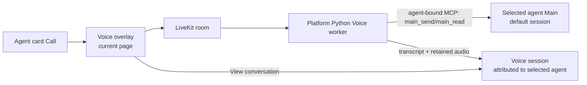

# Voice mode

Status: implementation in progress. Slices 01, 02, and 04–07 are complete.
Slice 03 remains RED with its local controller and budget-proof mechanics
complete; external Cloud/mobile/provider-privacy runs remain open.

Last updated: 2026-08-02.

## Next Agent Prompt

Finish Slice 03's external evidence before starting product runtime work. Build
the checked browser bundle, open the matrix runner's one-time URL in physical
mobile Safari, tap its single audio-arm control, and run the manifest-owned
desktop/mobile Cloud matrix with true cold activations. Inspect every provider
dashboard for absence after each `record=False` attempt. Preserve one redacted
row per attempt, activation fingerprint, and explicit RED stop/go evidence; do
not start the production worker or choose provider/model/codec topology from
local candidates.

Before every behavior change, invoke `write-tests` and work red/green. Before
every visual change, invoke `ui-playground`; judge candidate shots with
`compare-screenshots`, then run an unprimed `screenshot-critique`. Use
`preview-shots` as a non-blocking checkpoint: leave the shots open for roughly
five minutes, record any feedback that arrives, then continue from the
evidence. Human approval is not a gate.

This is a hard-cut feature. Do not add compatibility readers, legacy worker
paths, dual writers, migration scaffolding, or deploy-order bridges. Existing
text sessions and the ordinary unbound MCP surface remain their current
canonical products; Voice does not wrap or version them.

Slice 08 remains gated by Slice 03. The final staging journey has one warning:
the ordinary Main path recently showed an external agent-runtime 401, so Slice
10 must preflight it rather than building a Voice fallback.

**Exact pickup:** obtain the required LiveKit project values, select the third
public Fish stock voice, supply `cloudflared` and a true cold-activation script,
then run `cloud-matrix` with one physical iOS Safari controller through all 245
desktop/mobile attempts. Check the LiveKit/provider dashboards after every
attempt and turn `cloud_absence_verified` true only from that external proof.

**Global TODO:**

- [x] [01 — Call affordance](slices/01-call-affordance.md)
- [x] [02 — Voice overlay playground](slices/02-overlay-playground.md)
- [ ] [03 — runtime and heard-audio spike](slices/03-runtime-and-heard-audio-spike.md)
- [x] [04 — Main-turn correlation proof](slices/04-main-correlation-proof.md)
- [x] [05 — retained Voice session and audio](slices/05-voice-session-and-audio.md)
- [x] [06 — call ticket and bound credential](slices/06-call-ticket-and-credential.md)
- [x] [07 — agent-bound MCP and Voice input](slices/07-bound-mcp-and-voice-input.md)
- [ ] [08 — platform Voice worker](slices/08-platform-voice-worker.md)
- [ ] [09 — live browser call and retained view](slices/09-browser-call-and-retained-view.md)
- [ ] [10 — staging journey and closeout](slices/10-staging-closeout.md)

Before ending an implementation pass, update this status, date, exact pickup,
warnings, and checklist together with the owning slice. If a slice exposes a
decision not frozen here or in its named evidence artifact, stop and reslice
instead of deciding silently.

## Goal

Let a user start a responsive, full-duplex voice call from any launchable agent
card. A platform Voice runtime handles turn-taking and harmless social speech,
but checks every substantive discussion with the selected agent's existing
default session, where the agent's memory and normal tools already live.

Each activation creates a retained Voice conversation attributed to the
selected visible agent. Its transcript and user audio are saved, and agent
audio is saved only to the point actually played. The selected agent's Main
default session remains a separate reasoning channel.

## Frozen product semantics

- Voice is a platform worker and prompt runtime, not a workspace agent. It has
  no agent row, roster card, listing, files, memories, training surface, or
  independently visible identity.
- The Call icon sits immediately beside Train in the existing right-hand action
  cluster on `AgentRosterCardView`.
- Call is present for pinned Duet/root and every custom agent after its lock
  state resolves to `launchable && !locked`. It is absent while lock state is
  unresolved and for broken, disabled,
  onboarding-locked, and otherwise non-launchable cards.
- A call opens over the current page: compact modal on desktop, full-screen
  sheet on mobile. It never uses ComposeBar and never navigates to a call route.
- The pre-call view names the selected agent and says: **“Audio and transcript
  will be saved to this conversation.”** This is shown before microphone
  permission is requested.
- During a call, the surface shows only selected-agent identity, a small
  “Voice mode” label, one rolling caption, state, Mute, and End. It is not a
  timeline or text composer.
- End leaves the user on the same page. The ended state offers Close and View
  conversation. View conversation opens the retained Voice session.
- Every activation creates a new retained Voice session. Automatic resume,
  pairing registries, and reconnecting an old call are deferred.
- Barge-in stops Voice playback and returns Voice to listening. It does not
  cancel, interrupt, or steer work already accepted by Main.

## Truth boundary

The fast Voice model may speak without Main only for this closed set:

```text
greeting | social_small_talk | acknowledgement | audio_clarification |
call_status | call_control | error
```

Every fact, explanation, opinion, recommendation, plan, interpretation,
action, memory-dependent statement, and substantive follow-up must first call
the selected agent's Main default session. Uncertainty routes to Main. If Main
is unavailable, Voice says it cannot verify rather than answering from its own
knowledge.

Voice paraphrases Main for speech while preserving caveats, questions, and
uncertainty. The ASR transcript is the only user input sent to Main. A durable
`inputMode: "voice"` marker causes the gateway to add an ephemeral system
reminder about likely spelling, name, homophone, punctuation, and segmentation
errors; the canonical transcript itself is never rewritten.

## Architecture



The browser gets only a room-scoped LiveKit participant token. The worker gets
a one-time ticket through explicit LiveKit dispatch metadata, exchanges it for
an expiring MCP-audience `voice_call` credential, and receives only the bound
Main tools. No browser session or reusable workspace credential crosses into
LiveKit Cloud.

## Public seams

### Call activation

```http
POST /v1/ws/:workspaceSlug/voice/calls
Authorization: browser session
Content-Type: application/json

{ "agent": { "kind": "root" }, "clientRequestId": "uuid" }
{ "agent": { "kind": "custom", "agentId": "..." }, "clientRequestId": "uuid" }
```

```ts
type CreateVoiceCallResponse = {
  callId: string
  voiceSessionId: string
  livekitUrl: string
  participantToken: string
  connectExpiresAt: number
  callEndsAt: number
}
```

The response never includes the worker ticket or a Duet credential.

### Worker exchange

```http
POST /v1/voice/calls/exchange
Content-Type: application/json

{ "ticket": "single-use high-entropy value" }
```

The ticket is consumed atomically and returns an expiring `voice_call`
credential plus the canonical MCP URL. The URL is agent-bound:

```text
https://service.example.invalid/?agent=root
https://service.example.invalid/?agent=<agent-slug>
```

The credential and query binding must agree. An unbound ordinary credential
may use the same query as a first-class MCP server feature; a `voice_call`
credential can never request the general tool registry.

### Agent-bound MCP view

The LLM-visible registry contains exactly three tools and no workspace, agent,
call, or session selector:

```ts
main_send({
  kind: "request" | "answer"
  text: string
  clientRequestId: string // UUID
}): Promise<{
  created: boolean
  delivery: "accepted" | "queued"
  startCursor: number
}>

main_read({
  clientRequestId: string // UUID returned to the worker's correlation ledger
  cursor: number // startCursor first; then the last returned cursor
}): Promise<
  | { state: "working"; cursor: number }
  | { state: "question"; cursor: number; text: string }
  | { state: "complete"; cursor: number; text: string }
  | { state: "sleep" | "interrupted"; cursor: number; text?: string }
  | { state: "unavailable"; reason: string; cursor?: number }
>

main_cancel(): Promise<{ state: "interrupted" | "idle" }>
```

`main_send(kind: "request")` always targets the selected agent's default
session with `behavior: "follow_up"` and `inputMode: "voice"`.
`kind: "answer"` is valid only when that default session is asking a question.
The MCP adapter consumes Slice 04's full internal `MainSendReceipt`, including
the Main session ID needed for server-side routing, then projects only
`created`, `delivery`, and `startCursor` to the Voice model. `main_read` uses
that cursor and never infers ownership from “the latest output.”
`main_cancel` interrupts only the bound default session's current work and is
used solely after an explicit spoken request to cancel that work; barge-in and
End never call it.

### Retained call record

Existing `agentSessions` rows and text-session schemas are unchanged. A new
`voiceCalls` row keyed one-to-one by `voiceSessionId` denotes the Voice channel,
owns room/binding/expiry, and lets session summaries project
`channel: "voice"` only for those rows. Creating a call creates an ordinary
selected-agent session with a system-owned title and no fake user prompt.
The existing session status plus Voice start/end events remain the sole durable
lifecycle owner; `voiceCalls` does not duplicate a state machine.

Voice-specific events are appended to the existing session event log:

```ts
type VoiceMessageEvent = {
  type: "voice_message"
  utteranceId: string
  role: "user" | "agent"
  transcript: string
  startedAtMs: number
  endedAtMs: number
  audioMediaId: string
  source?:
    | { kind: "main"; clientRequestId: string }
    | { kind: "runtime"; category: VoiceRuntimeSpeechCategory }
  interrupted?: boolean
}
```

For user messages, `source` is omitted and the audio is the finalized utterance
received from the microphone. For agent messages, source is mandatory and the
referenced audio ends at the acknowledged played boundary. Audio uses a
dedicated `agentSessionAudio` owner for MIME, bytes, duration, storage, and
binary upload; the event stores only the ordered media reference. It does not
reuse
base64 image input or rename/migrate `agentSessionImages`.

Frozen initial limits are 60 minutes per call, 4 MiB per audio part, and
64 MiB retained audio per Voice session. Slice 03 may lower these limits when
measured codec/segment evidence requires it, but may not raise them silently.

## Single-owner invariants

- `AgentRosterCardView` presents the action; `AgentsWorkspace` owns the single
  selected call and renders one overlay across desktop/mobile roster layouts.
- `apps/web/spa/voice/` owns the pure UI state machine. The playground and live
  controller consume it; neither duplicates it.
- `voiceCalls` owns Voice-channel identity, room binding, and expiry; the
  existing session status/event log owns lifecycle. The Voice worker is not
  represented as an agent.
- `agentSessionAudio` alone owns retained audio metadata and deletion. Existing
  image storage remains the image owner; there is no generic compatibility layer.
- The default-session delivery path owns Main continuity and durable request
  correlation.
- The gateway's durable prompt composition owns the ASR reminder.
- MCP server construction owns the agent-bound tool projection. The Python
  worker does not filter a broader tool list after receiving it.
- The browser voice transport is the only web module allowed to own LiveKit
  networking.
- Duet is the retained record. LiveKit Inference is ZDR and LiveKit agent
  observability upload is disabled with `record=False`.

## Slice graph and review map

```text
01 Call affordance ──> 02 overlay playground ───────────────────────┐
03 runtime + heard-audio spike ────────────────────────────────┐    │
04 Main correlation proof ───────────────────────────────┐     │    │
05 Voice session + audio ────────────────┐               │     │    │
06 ticket + credential ──────────────────┼──> 07 bound MCP/input ──┤
03 + 04 + 05 + 06 + 07 ─────────────────────────> 08 worker ────────┤
02 + 05 + 06 + 08 ──────────────────────────────> 09 browser/view ──┤
all ─────────────────────────────────────────────────────> 10 staging
```

| Slice | Focused verdict | Playable/reviewable artifact |
| --- | --- | --- |
| 01 | Is Call discoverable without damaging the card hierarchy? | Roster action-cluster shots |
| 02 | Is the independent call surface understandable in all states? | Desktop/mobile real-component playground |
| 03 | Can the chosen stack meet latency/privacy and retain only heard output? | Cloud probe, audio fixtures, dated report |
| 04 | Can one Voice request deterministically own one Main result? | Race/terminal-state harness |
| 05 | Does a retained Voice session preserve ordered transcript/audio and delete it all? | API/storage integration harness |
| 06 | Can an external worker receive only a one-call credential? | Ticket replay and route-denial harness |
| 07 | Does the selected default session appear as three normalized tools with the ASR reminder? | Bound MCP inspector |
| 08 | Does Voice consult Main for every substantive utterance and speak responsively? | Policy eval + real-room worker probe |
| 09 | Does the real overlay call, interrupt, end, and open the retained record? | Live local call + regression shots |
| 10 | Does the deployed topology work and clean up on staging? | One selectable staging journey |

## Standing security and privacy gates

Read `SECURITY.md` before Slices 06–07. The workspace VM remains one trust
domain; no per-agent workspace capability is introduced. The new restriction
is justified because a credential crosses into an external LiveKit worker.

- Ticket: hashed at rest, 60-second TTL, one atomic exchange, replay rejected.
- Participant token: one room, join/publish audio only, five-minute connect TTL.
- Call: one participant plus the named worker, 60-minute hard end.
- `voice_call` credential: existing exact workspace sessions scope, MCP
  audience, call/session/agent binding, expires with the call plus at most two
  minutes, revoked on End.
- Browser activation rechecks membership and backend launchability. UI-only
  onboarding lock remains enforced by the card; the API does not pretend to
  read workspace files it cannot authoritatively inspect.
- The call credential is rejected from every API route except whoami, its exact
  call ingestion/end routes, and the selected owner's default-session routes
  reached through MCP.
- Logs, traces, screenshots, and staging artifacts contain no ticket, bearer,
  transcript, or audio content.

## Out of scope

- A hidden, official, installed, or per-workspace Voice agent.
- ComposeBar changes, a text mode switch, a call route, or an in-call timeline.
- Voice access to files, memory tools, training, integrations, roster, or the
  ordinary MCP registry.
- Automatic call resume, a Voice/Main pairing registry, multi-participant
  rooms, telephony, or custom cloned voices.
- Cancelling Main on barge-in or persisting Main reasoning/tool history in the
  Voice conversation.
- Self-hosted LiveKit, per-agent workers, direct Fish credentials in Duet, or
  LiveKit observability as the retained record.
- Backwards compatibility, legacy readers/writers, migrations, shims, and
  temporary dual ownership.

## Stop/go rules

- If Slice 03 cannot prove that retained agent audio excludes the unplayed TTS
  tail after interruption, stop. Do not retain the fully synthesized response.
- If Slice 04 cannot correlate a request through busy/queued/default-session
  races without “latest event” inference, add durable correlation before
  continuing.
- If Fish S2.1 Pro Free cannot meet the selected latency/reliability/privacy
  budget, record it as a rejected prototype provider and select a measured
  production Fish model; do not design the architecture around the temporary
  free window.
- If the live staging Main path is not reliably completing, the final journey
  is blocked on that external defect. Do not add a Voice-specific fallback.

See [MAP.md](MAP.md) for the full unknowns ledger,
[choices.md](choices.md) for accepted/rejected alternatives, and
[research/livekit-fish.md](research/livekit-fish.md) for dated external facts.
